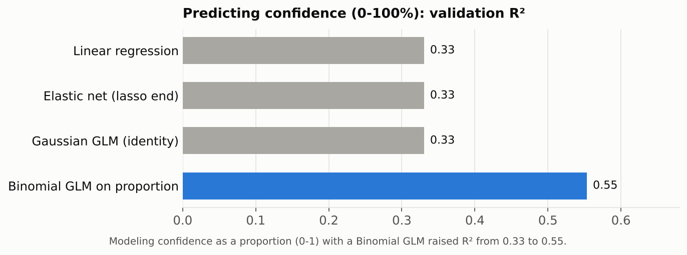
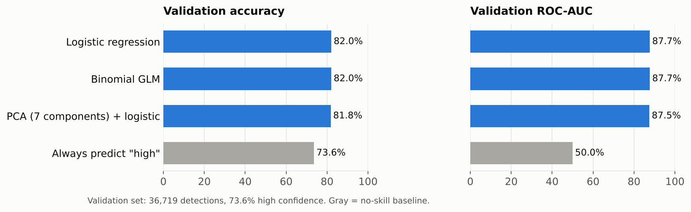
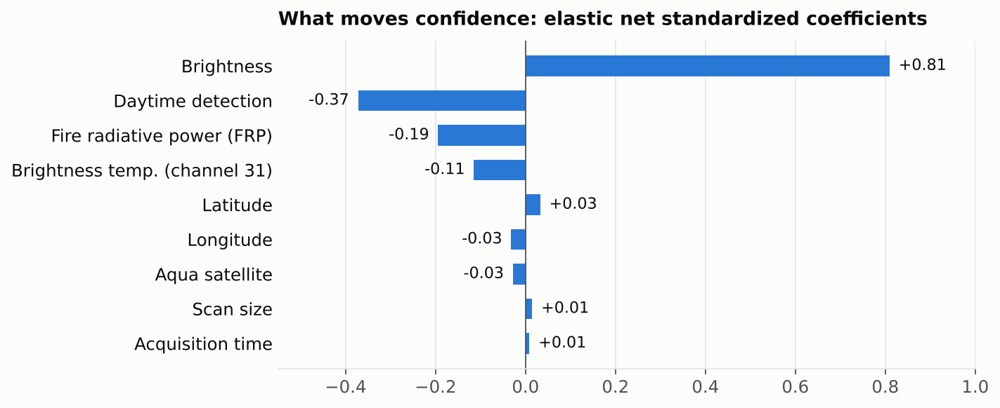

# Fire Identification from Satellite Data: Australia's 2019–2020 "Black Summer"

**Can NASA satellite measurements tell a high-confidence fire detection from a likely false alarm?**

Team project for STA 6704 *Data Mining II*, M.S. in Data Analytics, University of Central Florida (Summer 2026).
**Team:** Ryujin Bupp · Fernando Ricaurte · Hardik Polamarasetti

`Python` · `scikit-learn` · `statsmodels` · `mlxtend` · `pandas` · `matplotlib` · `seaborn`

---

## At a glance

| | |
|---|---|
| **Data** | 183,593 NASA MODIS active-fire detections over Australia, October 2019 to January 2020 |
| **Target** | `confidence` (0–100%), modeled two ways: as a continuous percentage, and as high (above 60%) vs. low |
| **Methods** | Logistic and linear regression baselines, exhaustive feature selection, elastic net, GLMs with matched target distributions, PCA, K-Means |
| **Best results** | Classification: **82% accuracy, ROC-AUC 0.88**. Regression: a Binomial GLM on the proportion raised **R² from 0.33 to 0.55** |

## Why it matters

The 2019–2020 bushfire season burned about 24 million hectares in Australia. Satellites flag thousands of possible fires, and every detection a fire service responds to costs staff time, equipment and money, whether or not the fire is real. NASA's MODIS sensors attach a **confidence** score to each detection. This project asks how well the other satellite measurements (brightness, fire radiative power, brightness temperature, scan geometry, time, location and satellite) predict that confidence, as a step toward sending crews where they are most needed.

## Approach

1. **Preprocessing.** No missing values. Dropped constant columns and the date field, one-hot encoded `satellite` and `daynight`, and standardized the numeric features. `scan` and `track` were almost perfectly correlated, so `track` was dropped, leaving 11 predictors.
2. **Splitting.** A 60/20/20 train/validation/test split (110,155 / 36,719 / 36,719). All results below are on the **validation set**.
3. **Two framings of the target.** Confidence as a continuous percentage (regression), and as a binary high/low label (classification). About 74% of detections are high confidence, so accuracy is compared against a no-skill baseline of 73.6%.
4. **Baselines.** Logistic and linear regression, with exhaustive feature selection (5-fold cross-validation) over every feature combination.
5. **Experiments.** Elastic net (Lasso and Ridge in one search), GLMs with distributions matched to each response, PCA to reduce the predictors, and K-Means clustering.

## Results

### Matching the distribution to the response mattered more than regularization



Linear regression explained only 33% of the variance in confidence. Elastic net cross-validation picked the pure-lasso end with an almost-zero penalty and gave **identical** results: once `track` was removed, there was little redundancy left to penalize.

What helped was rethinking the response. Confidence is a percentage bounded between 0 and 100, but a Gaussian model assumes an unbounded, symmetric response and can predict impossible values. Modeling confidence as a **proportion with a Binomial GLM (logit link)** respects that bound and raised validation R² from **0.33 to 0.55** (RMSE 20.4 → 16.7 percentage points).

### Classifying high vs. low confidence



| Model | Accuracy | ROC-AUC | Log-loss |
|---|---|---|---|
| Logistic regression | 82.04% | 87.69% | 0.388 |
| Binomial GLM (logit) | 82.03% | 87.70% | 0.388 |
| PCA (7 components) + logistic regression | 81.78% | 87.48% | — |
| Always predict "high" (baseline) | 73.62% | 50.00% | — |

- All three models beat the no-skill baseline and separate the classes well (ROC-AUC about 0.88).
- They are much better at confirming high-confidence detections (recall 0.91) than at catching low-confidence ones (recall 0.58), a result of the roughly 3:1 class imbalance.
- **PCA** cut 11 predictors to 7 components (95.8% of the variance) with almost no loss in performance.

### What drives confidence



**Brightness dominates** every model. Exhaustive feature selection chose brightness alone as the best subset for both baselines, and it has by far the largest standardized coefficient. Holding brightness constant, daytime detections score lower confidence than nighttime ones. In the logistic regression, fire radiative power and brightness had the largest coefficients.

### Clustering

K-Means on the PCA components found **9 clusters** (silhouette 0.30 training, 0.32 validation), so there is some structure but the groups overlap. The clusters were fit without the confidence label, yet one small cluster (2.2% of detections) turned out to be almost entirely high confidence (2,410 of 2,418).

## Limitations and next steps

- **The target comes from NASA's own algorithm.** MODIS assigns confidence using the same brightness measurements included here as predictors, so the models partly relearn that algorithm. Confirmed ground-truth fire reports would be a stronger target.
- Results are on the validation set; the 20% test set was held out and not used for these comparisons.
- Weather, vegetation and land-use data would likely add signal, along with nonlinear models and more tuning.

## Repository contents

| File | Description |
|---|---|
| [`Fire_Satellite_DataAnalysis_Code.ipynb`](Fire_Satellite_DataAnalysis_Code.ipynb) | Full analysis notebook with outputs: preprocessing, all models, PCA, clustering |
| [`report/Fire_Satellite_Analysis_Report.pdf`](report/Fire_Satellite_Analysis_Report.pdf) | Written project report, including an executive summary |
| [`fire_nrt_M6_96619.csv`](fire_nrt_M6_96619.csv) | Dataset: 183,593 detections, 14 columns |

## Reproduce

The dataset is included, so the notebook runs as is:

```bash
pip install -r requirements.txt
jupyter notebook Fire_Satellite_DataAnalysis_Code.ipynb
```

The saved outputs in the notebook show every result without re-running it.

## Data source

NASA Fire Information for Resource Management System (FIRMS), MODIS Collection 6 near-real-time active-fire detections, via the Kaggle dataset [*Fires from Space: Australia and New Zealand*](https://www.kaggle.com/datasets/carlosparadis/fires-from-space-australia-and-new-zeland) (Carlos Paradis).
